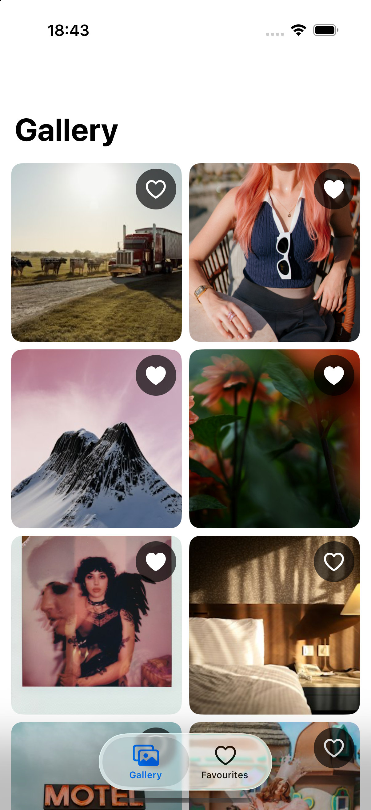
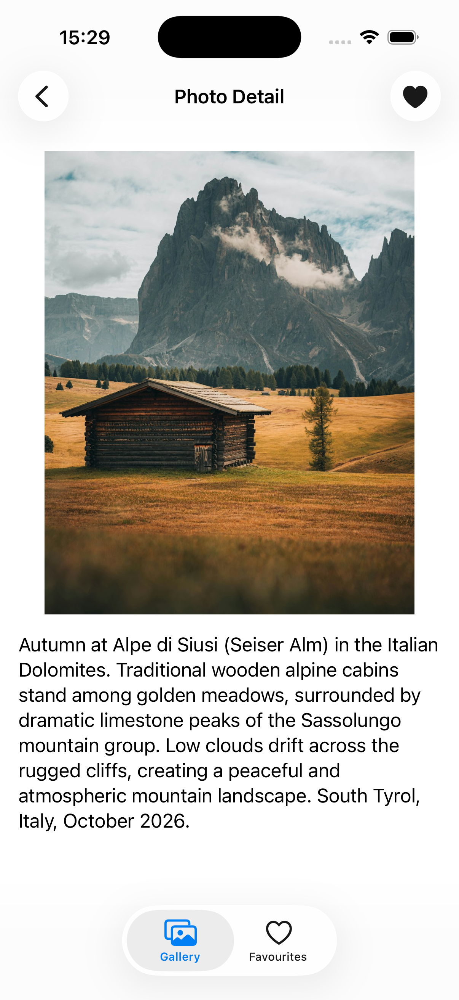
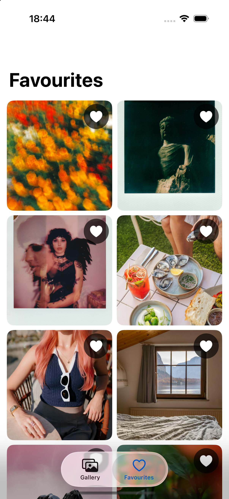

# GalleryApp

An iOS photo gallery built with UIKit. Browse Unsplash photos in a paginated grid, open a photo for details, swipe between photos, and save favourites on your device.

## Run locally

1. Open `GalleryApp.xcodeproj` in Xcode and get an Access Key from [Unsplash Developers](https://unsplash.com/developers).
2. Select the `GalleryApp` scheme and open **Product → Scheme → Edit Scheme → Run → Arguments**. Add and enable an environment variable named `UNSPLASH_ACCESS_KEY` with your Access Key. Keep the scheme setting local and leave the placeholder in [Constants.swift](GalleryApp/Shared/Constants.swift).
3. Select a simulator running iOS 17 or later, then press **⌘R**.

## Screenshots

  

## Architecture

GalleryApp uses MVVM and programmatic UIKit. `URLSession` fetches photo data, `NSCache` caches images in memory, and Core Data stores favourite photo metadata and URLs locally.

## Assumptions

- The gallery needs an internet connection and an Unsplash Access Key.
- Favourites remain available offline once their images are saved to the device. Older favourites get a local image copy the next time they are viewed online. Other images are cached in memory for the current session.

## Tests and linting

In Xcode, select the `GalleryApp` scheme and an iOS simulator, then press **⌘U**. The Swift Testing tests cover favourites persistence and the starting photo and boundaries of the pager. These two tests can run without an Unsplash Access Key.

The GalleryApp target runs SwiftLint during the Xcode build via `SwiftLintBuildToolPlugin`.

## Contact

[Iryna Mishchenko on GitHub](https://github.com/mishchenko11)
